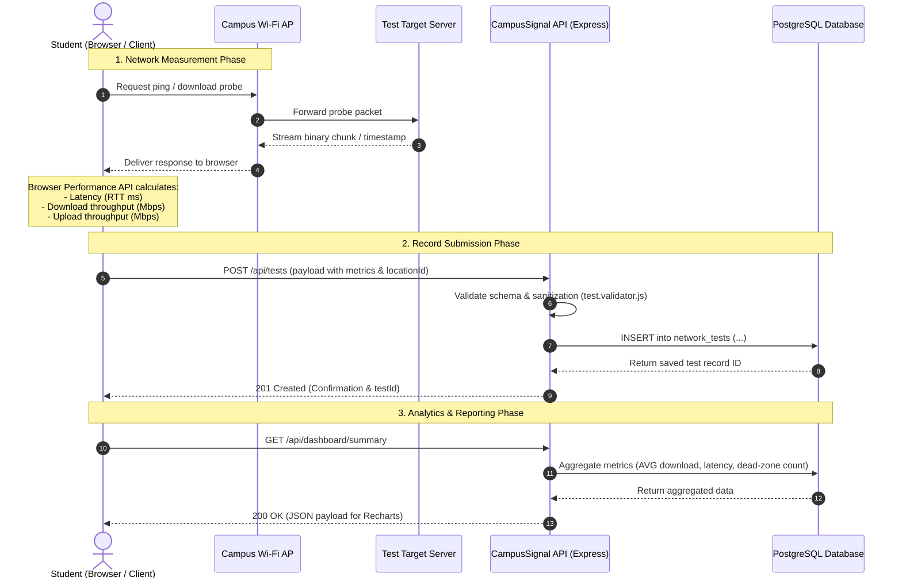

# CampusSignal – Technical Architecture
## System Design & Data Flow Specification

This document details the architectural boundaries, system components, networking mechanics, and data flow for the CampusSignal Wi-Fi Dead-Zone Mapper.

---

## 1. High-Level Architectural Flow

A core premise in network engineering is that **a backend server cannot measure a client's local Wi-Fi connection directly**. The measurement must originate from the client device itself as it traverses the local campus access point to a reachable network target.

---

## 2. Component Roles & Separation of Concerns

### A. Client Tier: Next.js / React (Student Browser)
- **Role:** User interface, client-side test execution orchestrator, and data visualization.
- **Why Next.js & React:**
  - Modern component hierarchy for modular layout (Sidebar, Metric Cards, Charts, Tables).
  - Fast page navigation via App Router (`/dashboard`, `/network-test`, `/locations`, `/history`, `/about`).
  - Strict separation of visual presentation from heavy backend computations.
- **Measurement Engine (Browser Execution Context):**
  - Uses the browser's `performance.now()`, `fetch()`, or `XMLHttpRequest` with `onprogress` event handlers.
  - Generates timed requests against designated server endpoints to measure real-world throughput and latency.
  - Captures device telemetry (User Agent, platform) to correlate device differences with Wi-Fi reception.

### B. Application Server Tier: Node.js & Express
- **Role:** Centralized REST API server, data validation layer, and aggregation coordinator.
- **Why Express:**
  - Lightweight, non-blocking asynchronous I/O runtime well-suited for collecting high volumes of telemetry submissions.
  - Explicit middleware chaining for CORS handling, logging, rate limiting, and centralized error handling.
- **Responsibilities:**
  - Expose clean RESTful endpoints (`/api/health`, `/api/locations`, `/api/tests`, `/api/dashboard/summary`).
  - Validate all submitted client measurements before persisting (checking realistic numerical ranges, non-negative numbers, valid foreign keys).
  - Act as the query router between client requests and PostgreSQL database connection pools.

### C. Test Target Strategy (Network Probing Endpoint)
- **Role:** Serve high-throughput chunked responses and receive payload buffers for bandwidth calculations.
- **Architecture Note:**
  - For small-scale educational networks, Express can serve dedicated static binary blobs (e.g., 1MB, 5MB, 10MB byte buffers) and an upload drain endpoint.
  - For high-accuracy production campus deployments, a dedicated lightweight static probe server (such as an Nginx instance or dedicated speed-test runner inside the campus LAN) should be utilized to prevent the main API server from suffering CPU/networking saturation during concurrent speed tests.

### D. Data Persistence Tier: PostgreSQL & `pg` Driver
- **Role:** Relational data storage, indexing, and time-series aggregation.
- **Why PostgreSQL:**
  - Network measurement data is inherently structured (IDs, floats, integers, timestamps, categorical campus zones).
  - Relational joins between `locations` (Buildings/Floors) and `network_tests` provide immediate relational integrity.
  - Efficient aggregate query functions (`AVG()`, `PERCENTILE_CONT()`, `STDDEV()`, `COUNT()`) allow server-side dashboard computations without pulling raw records to client memory.
  - Connection pooling via `pg.Pool` prevents database exhaustion under peak campus usage.

---

## 3. Network Measurement Methodology Principles

| Metric | Target Mechanism | DCN Theory Applied |
| :--- | :--- | :--- |
| **Latency (Ping)** | Rapid round-trip HTTP GET or WebSocket handshake requests (sample size $\ge 5$). | Round-Trip Time (RTT) including propagation, queuing, and serialization delays. Jitter calculated as variance in successive ping timings. |
| **Download Throughput** | Fetching standardized fixed-size payload streams (e.g., 2MB to 10MB) and calculating bytes received divided by elapsed time ($\Delta t$). | Measures sustained TCP throughput over local 802.11 Wi-Fi link and campus core switch infrastructure ($Mbps = \frac{Bytes \times 8}{\Delta t \times 10^6}$). |
| **Upload Throughput** | Sending random byte arrays (`Blob` / `ArrayBuffer`) via HTTP POST and measuring upload completion time. | Tests client RF transmission efficiency and uplink congestion to the local Access Point (AP). |
| **Dead-Zone Classification** | Composite formula evaluating whether average download $< 2 \text{ Mbps}$ or latency $> 250 \text{ ms}$ or packet drop occurs. | Quantifiable network thresholding to categorize zones as *Good*, *Moderate*, or *Dead Zone / Poor*. |

---

## 4. Security & Environment Architecture

1. **Environment Decoupling:**
   - Frontend accesses only public configurations prefixed with `NEXT_PUBLIC_` (`NEXT_PUBLIC_API_BASE_URL`).
   - Backend holds database credentials, internal ports, and CORS origins in server-side `.env` (strictly excluded from Git).
2. **CORS Governance:**
   - Express restricts incoming HTTP headers to the configured `FRONTEND_ORIGIN` (e.g., `http://localhost:3000`).
3. **Data Sanitization:**
   - All database interactions use parameterized SQL statements to eliminate SQL injection vulnerabilities.
   - Input payloads validate field boundaries (e.g., negative ping values or absurd throughputs $> 10 \text{ Gbps}$ are rejected).
