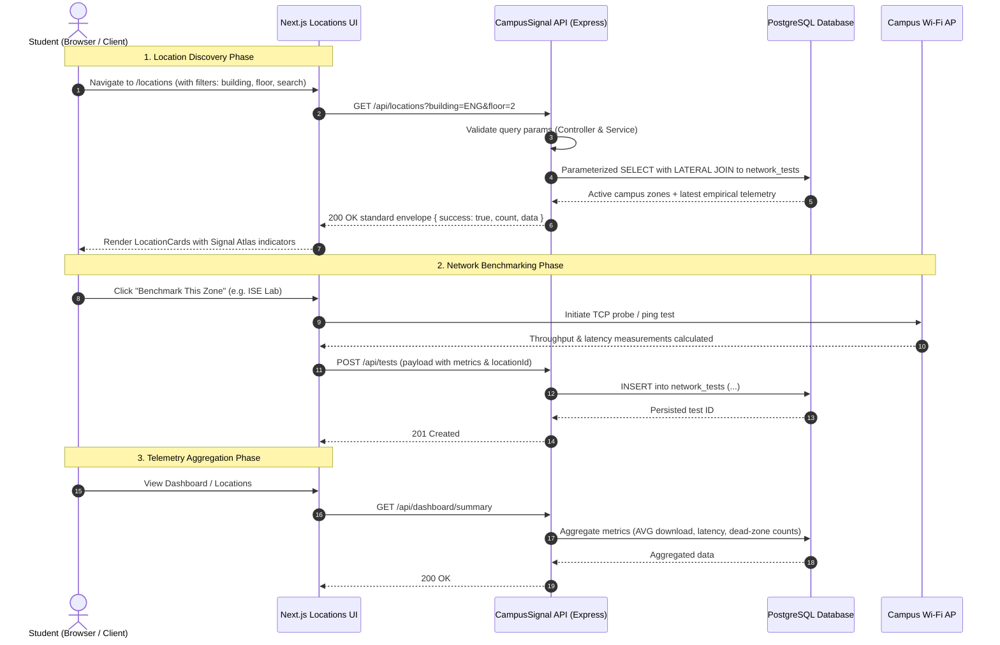
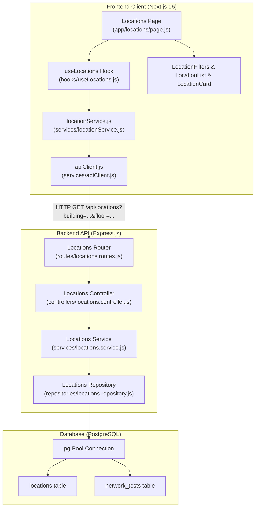

# CampusSignal – Technical Architecture
## System Design, Layering & Data Flow Specification

This document details the architectural boundaries, system components, networking mechanics, layered patterns, and data flow for the CampusSignal Wi-Fi Dead-Zone Mapper, with an in-depth breakdown of the **Campus Locations Module**.

---

## 1. High-Level Architectural Flow

A core premise in network engineering is that **a backend server cannot measure a client's local Wi-Fi connection directly**. The measurement must originate from the client device itself as it traverses the local campus access point to a reachable network target.



---

## 2. Component Roles & Separation of Concerns

### A. Client Tier: Next.js / React (Student Browser)
- **Role:** User interface, client-side test execution orchestrator, and data visualization.
- **Why Next.js & React:**
  - Modern component hierarchy for modular layout (`Sidebar`, `MobileNavigation`, `LocationFilters`, `LocationList`, `LocationCard`).
  - Fast page navigation via App Router (`/dashboard`, `/network-test`, `/locations`, `/history`, `/about`).
  - Strict separation of visual presentation from heavy backend computations.
- **Signal Atlas Design System:**
  - Crisp GIS-inspired palette: Main background `#FFFFFF`, subtle borders `#E4E8EC`, terracotta accent `#B84C3A`, healthy coverage `#39836A`, weak coverage `#D5A342`.
  - Accessible touch targets, responsive desktop sidebar, and mobile drawer/bottom bar navigation.

### B. Application Server Tier: Node.js & Express
- **Role:** Centralized REST API server, request validation layer, and business logic coordinator.
- **Why Express (ES Module Format):**
  - Lightweight, non-blocking asynchronous I/O runtime well-suited for collecting high volumes of telemetry submissions.
  - Explicit middleware chaining for CORS handling, JSON payload parsing, and centralized error handling.
- **Responsibilities:**
  - Expose clean RESTful endpoints (`/api/health`, `/api/locations`, `/api/tests`, `/api/dashboard/summary`).
  - Validate all submitted client measurements before persisting (checking realistic numerical ranges, non-negative numbers, valid foreign keys).
  - Act as the query router between client requests and PostgreSQL database connection pools.

### C. Data Persistence Tier: PostgreSQL & `pg` Driver
- **Role:** Relational data storage, indexing, and time-series aggregation.
- **Why PostgreSQL:**
  - Network measurement data is inherently structured (IDs, floats, integers, timestamps, categorical campus zones).
  - Relational joins between `locations` (Buildings/Floors) and `network_tests` provide immediate relational integrity.
  - Efficient aggregate query functions (`AVG()`, `PERCENTILE_CONT()`, `STDDEV()`, `COUNT()`) allow server-side dashboard computations without pulling raw records to client memory.
  - Connection pooling via `pg.Pool` prevents database exhaustion under peak campus usage.

---

## 3. Locations Module Architecture (3-Tier Layering)

The Locations module strictly implements the **Controller-Service-Repository** architectural pattern:



### 1. Routes (`backend/src/routes/locations.routes.js`)
- Maps HTTP verbs to controller actions:
  - `GET /api/locations`: Calls `controller.list`
  - `GET /api/locations/:id`: Calls `controller.get`
- Wraps handlers with `asyncHandler` middleware to capture unhandled promise rejections and forward them cleanly to the centralized `errorHandler`.

### 2. Controller (`backend/src/controllers/locations.controller.js`)
- Extracts HTTP request data: query parameters (`building`, `floor`, `search`) and route parameters (`id`).
- Performs input type validation (e.g. verifying that `floor` is an integer, rejecting malformed floor inputs with HTTP 400 Bad Request).
- Enforces UUID v4 format verification on single-location lookups.
- Wraps service results in the standard JSON response envelope:
  ```json
  {
    "success": true,
    "status": "success",
    "count": 3,
    "data": [...]
  }
  ```

### 3. Service (`backend/src/services/locations.service.js`)
- Encapsulates domain logic for campus locations.
- Sanitizes query filters: trims whitespace, enforces maximum string lengths (100 characters), and validates numerical floor bounds (-10 to 100).
- Coordinates data retrieval with the repository layer.
- Ensures consistent array returns even when underlying queries return empty sets.

### 4. Repository (`backend/src/repositories/locations.repository.js`)
- Directly executes parameterized SQL queries against PostgreSQL using the shared connection pool (`requirePool()`).
- Eliminates SQL injection vulnerabilities by binding inputs via positional parameters (`$1`, `$2`, `$3`).
- Performs a `LEFT JOIN LATERAL` against the `network_tests` table to correlate each location with its most recent empirical Wi-Fi test (download speed, latency, quality category).
- Orders results consistently: `ORDER BY l.building_name ASC, l.floor ASC, l.zone_name ASC`.

---

## 4. Database Schema Alignment

The locations module directly queries the canonical relational tables defined by the database team:

```sql
-- locations table (from migration 001_create_tables.sql)
CREATE TABLE IF NOT EXISTS locations (
    id UUID PRIMARY KEY DEFAULT gen_random_uuid(),
    building_name VARCHAR(100) NOT NULL CHECK (length(trim(building_name)) > 0),
    floor INTEGER NOT NULL,
    zone_name VARCHAR(120) NOT NULL CHECK (length(trim(zone_name)) > 0),
    description TEXT,
    target_ap VARCHAR(64),
    is_active BOOLEAN NOT NULL DEFAULT true,
    created_at TIMESTAMPTZ NOT NULL DEFAULT NOW(),
    CONSTRAINT uq_location_building_floor_zone UNIQUE (building_name, floor, zone_name)
);
```

No columns have been invented or altered. Only verified schema attributes (`id`, `building_name`, `floor`, `zone_name`, `description`, `target_ap`, `is_active`, `created_at`) are utilized.

---

## 5. Security & Network Protocols

1. **SQL Injection Prevention:** All SQL queries in `locations.repository.js` strictly use parameterized `$1`, `$2` placeholders. No string concatenation of user-provided values is permitted.
2. **Input Validation:** Incoming filter parameters (`building`, `floor`, `search`, and UUID `id`) are sanitized in both the controller and service layers.
3. **CORS Governance:** The Express server restricts incoming HTTP origins to the configured `FRONTEND_ORIGIN` (`http://localhost:3000`).
4. **Environment Segregation:** Secrets and database credentials reside exclusively in the server `.env` file (excluded from git), while the client consumes `NEXT_PUBLIC_API_BASE_URL`.
