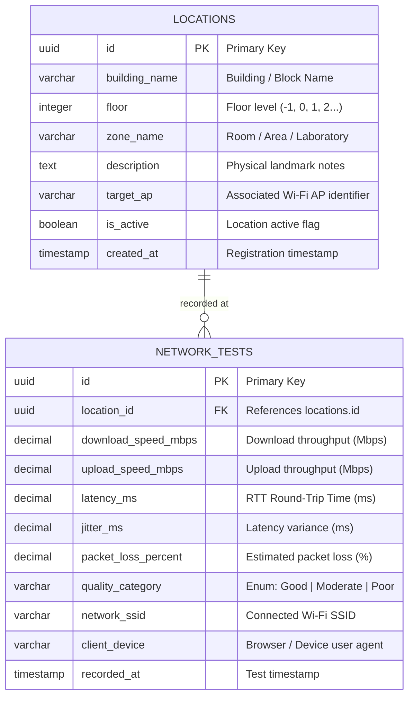

# CampusSignal – Relational Database Design Plan

> [!IMPORTANT]
> **Status: PLANNED, NOT IMPLEMENTED.**  
> This document details the proposed relational database entities, fields, keys, data types, and query indexes.  
> **No database schemas, tables, migrations, or SQL execution have taken place.** The PostgreSQL client driver (`pg`) has been installed in `backend/` for future integration.

---

## 1. Entity-Relationship Model Overview

CampusSignal models campus network quality as a relational time-series dataset. The data structure centers on two primary entities:
1. **`locations`**: Represents physical zones across campus (buildings, floors, rooms, outdoor quads).
2. **`network_tests`**: Represents individual telemetry observations captured at a specific location.



---

## 2. Entity Descriptions & Field Specifications

### 2.1 Entity: `locations`
Represents physical campus testing zones where Wi-Fi access points are deployed or where students convene.

| Field Name | Data Type | Constraints | Description |
| :--- | :--- | :--- | :--- |
| `id` | UUID | PRIMARY KEY, Default `gen_random_uuid()` | Unique immutable location identifier |
| `building_name` | VARCHAR(100) | NOT NULL | Name of campus building (e.g., *Academic Block A*, *Library*) |
| `floor` | INTEGER | NOT NULL | Floor index (`0` for Ground, `1` for First Floor, etc.) |
| `zone_name` | VARCHAR(120) | NOT NULL | Specific room or landmark (e.g., *ISE Lab 3*, *Cafeteria Quad*) |
| `description` | TEXT | NULLABLE | Detailed location guidance (e.g., *Near window facing east*) |
| `target_ap` | VARCHAR(64) | NULLABLE | Optional Access Point MAC address or BSSID/label if known |
| `is_active` | BOOLEAN | NOT NULL, DEFAULT `true` | Allows deactivating remodeled or decommissioned rooms |
| `created_at` | TIMESTAMPTZ | NOT NULL, DEFAULT `NOW()` | Timestamp when location was registered |

---

### 2.2 Entity: `network_tests`
Stores the empirical network measurement metrics captured by a student's device.

| Field Name | Data Type | Constraints | Description |
| :--- | :--- | :--- | :--- |
| `id` | UUID | PRIMARY KEY, Default `gen_random_uuid()` | Unique identifier for each test execution |
| `location_id` | UUID | NOT NULL, FOREIGN KEY (`locations.id`) ON DELETE CASCADE | Reference to physical location where test occurred |
| `download_speed_mbps` | DECIMAL(8, 2) | NOT NULL, CHECK ($\ge 0.0$) | Calculated download throughput in Megabits per second |
| `upload_speed_mbps` | DECIMAL(8, 2) | NOT NULL, CHECK ($\ge 0.0$) | Calculated upload throughput in Megabits per second |
| `latency_ms` | DECIMAL(8, 2) | NOT NULL, CHECK ($\ge 0.0$) | Average round-trip time in milliseconds |
| `jitter_ms` | DECIMAL(8, 2) | NULLABLE, CHECK ($\ge 0.0$) | Statistical deviation between consecutive ping packets |
| `packet_loss_percent`| DECIMAL(5, 2) | NULLABLE, CHECK ($0.0 \le x \le 100.0$) | Percentage of probes dropped or timed out |
| `quality_category` | VARCHAR(16) | NOT NULL, CHECK in (`'Good'`, `'Moderate'`, `'Poor'`) | Categorical rating assigned by business rules |
| `network_ssid` | VARCHAR(64) | NULLABLE | Campus SSID reported by student (e.g., *College-Student-Wi-Fi*) |
| `client_device` | VARCHAR(255) | NULLABLE | Operating system and browser snippet for telemetry |
| `recorded_at` | TIMESTAMPTZ | NOT NULL, DEFAULT `NOW()` | Precise timestamp when test was saved |

---

## 3. Relational Logic & Cardinality

- **One-to-Many Relationship:** One `location` record has zero, one, or many associated `network_tests`.
- **Referential Integrity:** Deleting a location will cascade-delete or soft-delete its child test records based on campus data retention policy.
- **Aggregation Support:** The relational structure allows efficient SQL queries:
  ```text
  -- Conceptual aggregation (for Phase 2 implementation)
  SELECT 
    l.zone_name,
    AVG(t.download_speed_mbps) as avg_download,
    AVG(t.latency_ms) as avg_ping,
    COUNT(t.id) as test_count
  FROM locations l
  JOIN network_tests t ON l.id = t.location_id
  GROUP BY l.id, l.zone_name
  HAVING AVG(t.download_speed_mbps) < 2.0;
  ```

---

## 4. Planned Indexing Strategy (Phase 2)

To ensure rapid query responses on the dashboard even with thousands of historical campus test records, the following indexes are planned:
1. `idx_network_tests_location_id`: B-Tree index on `network_tests(location_id)` for lightning-fast location joins.
2. `idx_network_tests_recorded_at`: B-Tree index on `network_tests(recorded_at DESC)` for chronological ordering and range filtering.
3. `idx_network_tests_quality`: Index on `network_tests(quality_category)` to quickly aggregate dead-zone statistics.
