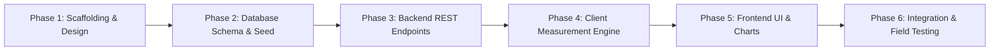

# CampusSignal – Wi-Fi Dead-Zone Mapper
## Project Overview & Initiation Document

**Team Name:** SignalX  
**Academic Context:** 3rd Year Information Science and Engineering (ISE) — Data Communication & Networking (DCN) Mini-Project  
**Status:** Project Initialized (Phase 1: Planning & Scaffolding Complete)

---

## 1. Team Members & Roles

| Name | USN | Core Responsibility Area |
| :--- | :--- | :--- |
| **Abhinandana S** | 4SF24IS002 | Frontend Architecture, Next.js UI Design & Layouts |
| **Ankitha GR** | 4SF24IS015 | Network-Testing Research & Measurement Methodology |
| **Yashwanth** | 4SF24IS124 | Backend Architecture, Express APIs & Database Planning |
| **Santosh** | 4SF24IS100 | Quality Assurance, Testing Strategy & Dashboard Requirements |

---

## 2. Problem Statement

Across college campuses, students, faculty, and research scholars frequently encounter weak, erratic, or completely non-existent Wi-Fi connectivity in specific buildings, lecture halls, labs, and outdoor areas. These "dead zones" impede academic productivity, disrupt online lab submissions, and degrade the overall digital learning experience.

Currently, campus IT management lacks an empirical, crowd-sourced visibility tool to pinpoint exact locations of network degradation. Network assessments are either conducted infrequently using specialized handheld hardware or based solely on anecdotal complaints that lack technical telemetry (latency, packet loss, bandwidth).

**CampusSignal** bridges this gap by providing an intuitive, web-based platform allowing students and staff to measure real-time network performance from any connected device at their current campus location, compile telemetry into a centralized database, and present actionable analytical dashboards for infrastructure improvements.

---

## 3. Project Objectives

1. **Location-Centric Telemetry:** Enable students to select their current campus building, floor, and zone to attribute measurements accurately.
2. **Standardized Measurement Suite:**
   - **Download Speed:** Measure sustained payload transfer rates from a known server endpoint.
   - **Upload Speed:** Measure payload transmission speeds from the client to the server endpoint.
   - **Round-Trip Time (Latency/Ping):** Measure HTTP/TCP response times over multiple samples to compute average latency and jitter.
3. **Relational Record Keeping:** Store structured test records linked to campus locations with timestamps, user agent data, and network metrics.
4. **Actionable Visual Observability:**
   - Dashboard displaying campus-wide averages (Download, Upload, Ping).
   - Visual highlighting of identified "dead zones" (areas with consistently poor signal).
   - Location-by-location comparison charts to prioritize access point installations.
   - Historical trend analysis over hours, days, and weeks.
5. **Academic Rigor:** Serve as a practical study of Data Communication and Networking (DCN) principles including TCP/IP stack behavior, client-server latency, throughput bottlenecks, and web performance metrics.

---

## 4. Current Phase: Initialization Scope & Boundaries

> [!IMPORTANT]
> **Strict Phase 1 Scope:** This project is in its structural foundation and UI planning phase.
> - **No application logic, live database queries, simulated metrics, or fake data have been implemented.**
> - All components and routes exist as clean, structured architectural placeholders ready for feature-by-feature implementation in Phase 2.

---

## 5. Technology Stack Summary

- **Frontend:** Next.js 15 (React 19, App Router, JavaScript / JSX), Tailwind CSS v4, Lucide React (icons), Recharts (visualization).
- **Backend:** Node.js, Express (REST API), CORS, dotenv, pg (node-postgres client driver).
- **Database:** PostgreSQL (Relational database with schema for locations and test metrics).
- **Tooling:** npm, Git, VS Code, ESLint.

---

## 6. Implementation Roadmap

- **Phase 1 (Current):** Environment inspection, directory scaffolding, placeholder generation, UI guidelines, architectural documentation.
- **Phase 2:** PostgreSQL schema creation, migrations, seed data for campus buildings/floors.
- **Phase 3:** Express server setup, database connection pool, API controllers, input validation middleware.
- **Phase 4:** Client-side network testing methodology implementation (XHR/Fetch chunks, timing APIs).
- **Phase 5:** Next.js dashboard UI, Recharts graphs, telemetry submission flows, location browser.
- **Phase 6:** End-to-end testing across physical campus Wi-Fi access points, documentation finalization, project presentation.
